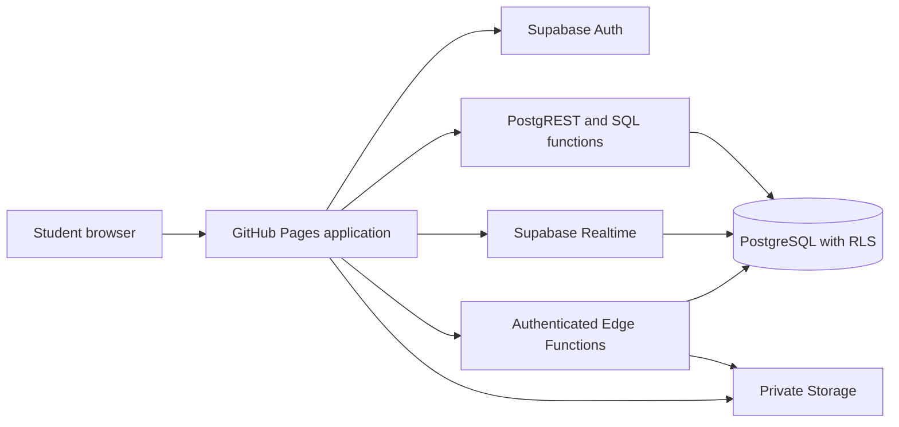

# StudyCircle architecture

React uses hash routes with relative assets for GitHub Pages. The browser carries a publishable Supabase key and the signed-in user's session. PostgREST and checked database functions serve reads and writes. PostgreSQL row policies enforce identity and membership. Realtime events notify authorized browsers to refresh affected records. Rooms derive the displayed phase from the stored start timestamp and durations.

Storage keeps educational attachments in private buckets. Edge Functions verify account deletion and resolve anonymous Q&A downloads. Database writes check authorization and use transactions and uniqueness constraints for state transitions.

The isolated classroom workspace uses an in-memory adapter and resets on refresh. The local Supabase seed provides an independent database-backed rehearsal path. See [DATABASE.md](DATABASE.md) and [SECURITY.md](SECURITY.md).
