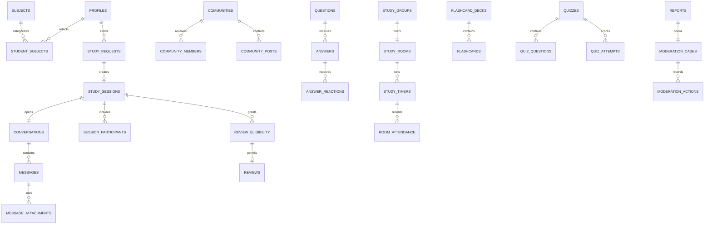

# StudyCircle database

The SQL files in `supabase/migrations` are the source of truth. Run them in order. Catalog rows are migration data. Fictional students belong to the local seed only.

| Area | Main records |
| --- | --- |
| Identity | Auth users, profiles, private profiles, roles, consent, institution, course and education level |
| Discovery | Subjects, topics, student subjects, preferences, availability, geographic regions and queues |
| Peer study | Requests, sessions, participants, conversations, chat presence, messages and attachments |
| Communities | Communities, channels, memberships, posts, comments, polls and bookmarks |
| Academic Q&A | Questions, private ownership, answers, comments and reactions |
| Group study | Groups, memberships, rooms, tasks, timers, attendance, announcements and shared resources |
| Study tools | Tasks, goals, exams, revision topics, focus logs, decks, cards, reviews, quizzes and attempts |
| Safety | Review entitlements, anonymous feedback, blocks, reports, cases, audit logs and appeals |
| Operations | Notifications, verification, badges and application settings |

A request acceptance transaction creates the session, participant rows and conversation. Completion, eligibility and review submission use locked rows. An anonymous question has a null public author and an owner mapping in the internal schema. Timers store their start time and durations. Quiz answer keys stay in the internal schema. Attempt results store the explanations at grading time.
